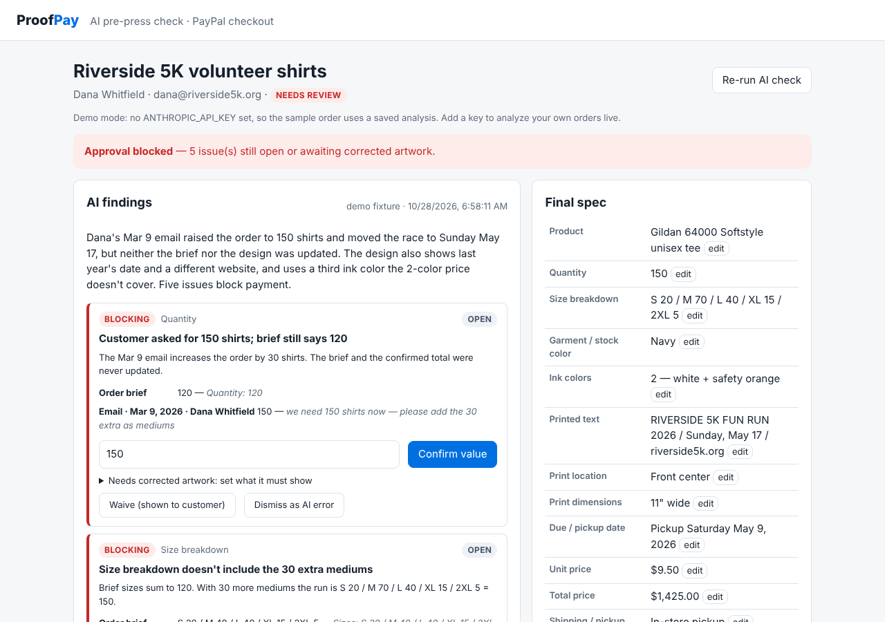
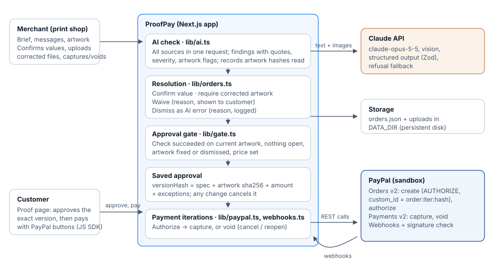
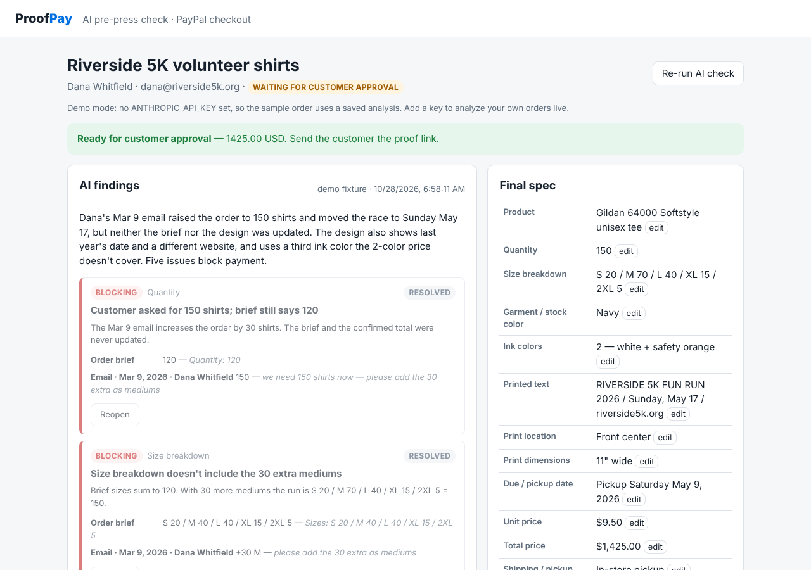
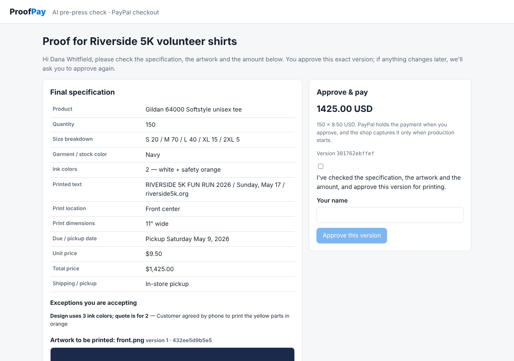
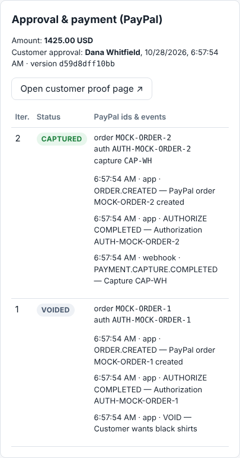
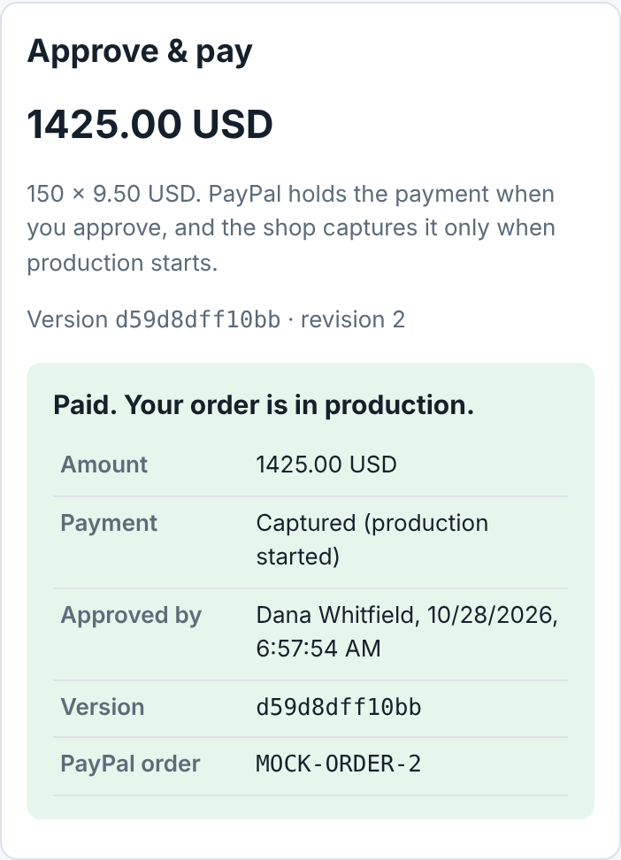

# ProofPay

**Catch mistakes in custom t-shirt orders before the customer pays, and tie the PayPal payment to the exact
version they approved.**

A t-shirt order lives in three places that drift apart: the shop's order brief, the email thread with the customer,
and the artwork file. The customer emails "make it 150", but the brief still says 120. The artwork still says last
year. A third ink color sneaks in that nobody priced. Shops find out after printing.

ProofPay is **AI-assisted verification backed by merchant and customer confirmation**. Claude reads the brief, the
messages and the artwork image together and flags mismatches in four areas: quantity and sizes, printed text and
dates, colors, and pricing. Each flag quotes its sources. The merchant settles every flag. If the artwork itself is
wrong, the merchant uploads a corrected file and the AI checks it again. The customer then approves one exact version,
covering the spec, the artwork files and the amount, and pays with PayPal. The payment is held until production starts.

The AI doesn't replace a human proof check: file hashes and evidence checks show it looked at the right file and cited
real text, not that it read the image perfectly. That's why the merchant confirms every value and the customer
approves the artwork itself.

> Built for the PayPal AI Hackathon 2026. PayPal **sandbox** only; no real money moves.



## Quickstart for judges

**Hosted demo:** _URL added once deployed (see [Deploy](#deploy))._

**Run it locally in 2 minutes, no keys needed (demo mode).** Requires Node.js 22 or newer.

```bash
git clone https://github.com/dngvmnh/PayPal-AI-Hackathon.git
cd PayPal-AI-Hackathon
npm install
npm run build && npm start        # http://localhost:3000
```

1. Click **Load sample order (Riverside 5K)**, then **Run AI check**. Without an Anthropic key, the sample uses a
   saved analysis.
2. Settle each finding: **Confirm value**, **Waive** (with a reason the customer will see), or **Dismiss as AI
   error** (with a logged reason).
3. When the banner turns green, click **Open customer proof page**. Tick the box, type a name, and click
   **Approve this version**.
4. To pay, add PayPal sandbox keys ([setup below](#paypal-sandbox-setup)) and use a sandbox *personal* account.
   Then go back to the order and click **Start production & capture**, **Void & reopen for changes**, or **Void &
   cancel order**.

**Without PayPal keys,** you can still exercise the whole payment flow against a local stand-in for the PayPal API.
It is not PayPal; it only returns responses in the same shape:

```bash
npm run mock:paypal                                    # terminal 1
PAYPAL_API_BASE=http://localhost:4010 PAYPAL_CLIENT_ID=x PAYPAL_CLIENT_SECRET=x \
  PAYPAL_WEBHOOK_ID=x npm start                        # terminal 2 (after npm run build)
npm run e2e                                            # terminal 3: 17 checks, approve → pay → void & reopen → pay → webhook capture
```

## How it works



1. **Collect sources.** The merchant creates an order with the brief, the pasted message thread, and artwork
   (PNG/JPG/WebP/GIF/PDF).
2. **AI check.** One Claude request gets every source, with the artwork as an image or PDF. It returns findings with
   a severity, quotes from each source, a suggested value, a question for the customer, and whether the artwork
   itself must change. The check records the fingerprint (sha256) of each artwork file it read.
3. **Resolve.**
   - **Spec errors:** the merchant confirms the value.
   - **Artwork errors:** the merchant sets what the artwork must show (year, date, name, URL, text line, ink
     colors), uploads a corrected file (kept as a new version), and re-runs the check.
   - **Waive:** a real issue is accepted, with a reason the customer will see.
   - **Dismiss:** the AI was wrong, with a reason that is logged.
4. **Approval gate** (`lib/gate.ts`). Approval is allowed only when:
   - the latest check succeeded on the current artwork;
   - no blocking or warning finding is open;
   - artwork errors were fixed by a new file or dismissed;
   - every waive or dismissal has a reason;
   - quantity and price are set.
5. **Customer approval.** The proof page shows the spec, the current artwork version, the amount and any waived
   exceptions. The customer approves that version, and the approval is saved on the server with a hash of all of it.
   **Any later change cancels the approval.**
6. **PayPal authorize.** Checkout uses `intent: AUTHORIZE`, so the money is held, not taken. `custom_id` carries the
   order, the revision and the approved version hash. The order is now locked.
7. **Capture or void.** The merchant captures when production starts. Or they void, either to cancel the order or to
   reopen it for changes; a reopened order needs a new approval and a new payment. Webhooks keep the status in sync
   with PayPal.

| Ready for approval | Customer approves the exact version |
|---|---|
|  |  |

| Payment revisions (voided, then captured) | Customer receipt on a phone |
|---|---|
|  |  |

_The payment screenshots were taken against the local PayPal stand-in, so the ids read `MOCK-ORDER-…`._

## Tools used

### PayPal

| Step | API |
|---|---|
| Checkout button on the proof page | PayPal JS SDK via `@paypal/react-paypal-js` (`PayPalButtons`, `intent=authorize`) |
| Create the order: line items, `custom_id` = `order:revision:versionHash`, `invoice_id` | Orders v2 `POST /v2/checkout/orders` |
| Hold the funds after the customer approved the version | Orders v2 `POST /v2/checkout/orders/{id}/authorize` |
| Take the funds when production starts | Payments v2 `POST /v2/payments/authorizations/{id}/capture` |
| Release the funds to cancel, or to reopen the order for changes | Payments v2 `POST /v2/payments/authorizations/{id}/void` |
| Keep status in sync: `PAYMENT.AUTHORIZATION.CREATED/VOIDED`, `PAYMENT.CAPTURE.COMPLETED/DENIED` | Webhook at `/api/paypal/webhook`, verified with `POST /v1/notifications/verify-webhook-signature` |

Every call sends a `PayPal-Request-Id`, so retries don't create duplicates. Code: `lib/paypal.ts`, `lib/webhooks.ts`.

### AI

| What | How |
|---|---|
| Model | Claude Opus 5.5 (`claude-opus-5-5`) through the official `@anthropic-ai/sdk` |
| Inputs | Brief and messages as text; artwork as image or PDF content blocks (vision) |
| Output | A Zod schema (`AIAnalysis` in `lib/types.ts`) enforced with structured outputs |
| Safety | Handles `refusal` stop reasons; server-side `fallbacks: "default"` |
| Demo mode | Without `ANTHROPIC_API_KEY`, the sample order uses a saved analysis (`samples/riverside-5k/demo-analysis.json`) |
| Evaluation | Sample orders with answer keys in `samples/` (format: `samples/FORMAT.md`), including 3 held-out cases in `samples/heldout/` |

Code: `lib/ai.ts`.

## Setup (full mode)

```bash
cp .env.example .env.local
```

| Variable | What it's for |
|---|---|
| `ANTHROPIC_API_KEY` | Live AI checks. From https://console.anthropic.com. Leave empty for demo mode |
| `PAYPAL_CLIENT_ID`, `PAYPAL_CLIENT_SECRET` | Sandbox REST app credentials (server side) |
| `NEXT_PUBLIC_PAYPAL_CLIENT_ID` | The same client ID, for the browser's PayPal buttons. Read at build time |
| `PAYPAL_WEBHOOK_ID` | Id of the webhook registered for this app. Needed to accept webhooks |
| `PAYPAL_API_BASE` | Defaults to the sandbox, `https://api-m.sandbox.paypal.com` |
| `DATA_DIR` | Where orders and uploads are stored. Defaults to `.data/`; point it at a persistent disk when hosting |
| `APP_BASE_URL` | Public URL of the app |

Check what is configured at `GET /api/health`.

### PayPal sandbox setup

1. Sign in at https://developer.paypal.com and open **Apps & Credentials** with the **Sandbox** toggle on.
2. **Create App** (type *Merchant*). Copy the **Client ID** into both `PAYPAL_CLIENT_ID` and
   `NEXT_PUBLIC_PAYPAL_CLIENT_ID`, and the **Secret** into `PAYPAL_CLIENT_SECRET`.
3. **Testing Tools → Sandbox Accounts:** PayPal creates a default *Business* account (receives the money) and a
   *Personal* account (pays). Use the personal account's email and password in the PayPal popup.
4. **Webhooks** (needs a public URL: the hosted app, or a tunnel to localhost). In the app's settings, add a webhook
   for `<APP_BASE_URL>/api/paypal/webhook` with the events `PAYMENT.AUTHORIZATION.CREATED`,
   `PAYMENT.AUTHORIZATION.VOIDED`, `PAYMENT.CAPTURE.COMPLETED` and `PAYMENT.CAPTURE.DENIED`. Copy its **Webhook
   ID** into `PAYPAL_WEBHOOK_ID`. The webhook simulator on the same page can send test events.
5. Restart the app (rebuild if you changed `NEXT_PUBLIC_PAYPAL_CLIENT_ID`). In the sandbox dashboard, the
   transaction's custom field shows `order:revision:versionHash`.

## Tests

```bash
npm test          # unit tests: gate, finding rules, artwork versions, approval cancellation,
                  # payment revisions, void/reopen, webhooks, sample answer keys
npm run typecheck
npm run e2e       # end-to-end against a running app + mock PayPal (see Quickstart)
```

## Deploy

`render.yaml` is a [Render](https://render.com) blueprint: **New → Blueprint →** this repo, then fill in the secret
environment variables. It mounts a 1 GB persistent disk at `/var/data` (`DATA_DIR`), so orders and artwork survive
redeploys. Render disks need a paid instance type. Any Node 22 host with a persistent folder works the same way:
`npm ci && npm run build`, then `npm start`.

After deploying, set `APP_BASE_URL`, register the webhook URL in the PayPal app, and add the URL to the top of this
README.

## Project layout

```
app/
  page.tsx                 order list
  orders/new/              new order form
  orders/[id]/             merchant workspace: findings, artwork versions, spec, approval & payment, history
  p/[id]/                  customer proof page: approve this version, PayPal buttons, receipt
  api/orders/...           create, read, analyze, finding actions, spec edits, artwork upload, approve,
                           PayPal create / authorize / capture / void
  api/paypal/webhook       verified PayPal webhook events
  api/health               which integrations are configured
lib/
  ai.ts                    Claude check: prompt, multimodal content, structured output
  gate.ts                  approval gate, version hash, artwork fingerprints
  orders.ts                state transitions: findings, artwork versions, approval, payments, status
  paypal.ts                PayPal REST client
  webhooks.ts              PayPal webhook events → payment revisions
  store.ts                 JSON-file storage in DATA_DIR
samples/                   sample orders, answer-key format, held-out eval cases
scripts/                   mock PayPal API and end-to-end check
docs/PLAN.md               MVP plan, decisions, task split
```

## License

MIT, see [LICENSE](LICENSE).
